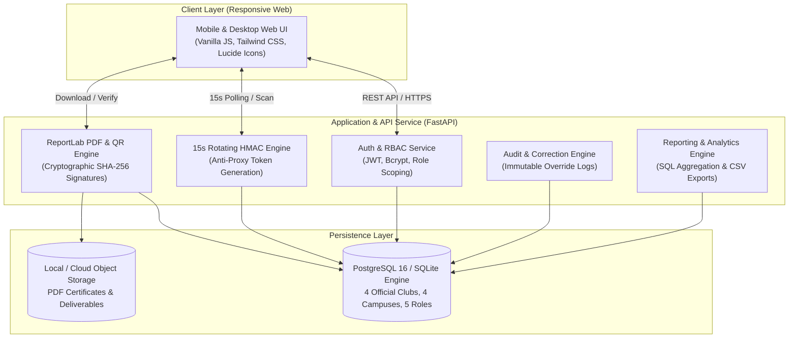
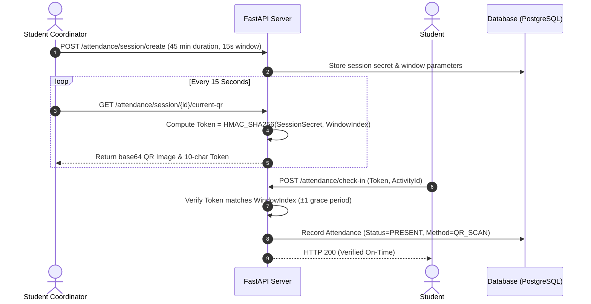
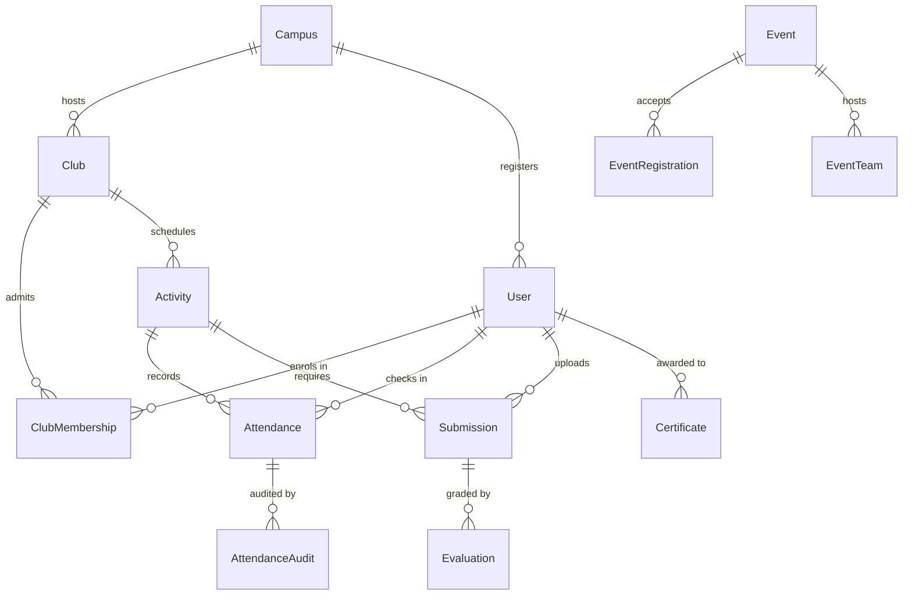

# MIRAI CLUBS — System Design Document
**Product:** Centralized Club Activities Tracker  
**Institution:** Mirai School of Technology (MSOT)  
**Standard:** Problem 5 Challenge Specification  
**Version:** 1.0.0 (Production Release — October 15, 2026)  

---

## 1. System Architecture & Component Overview

Mirai Clubs is engineered as a robust, low-latency, database-backed university platform managing the complete co-curricular lifecycle across 4 regional campuses and **4 officially sanctioned student organizations** (strict institutional limit enforced at API and database boundary).

### Core Architecture Principles:
1. **Verified Participation:** Every student credit requires a dual-factor verifiable trail (cryptographic check-in, submission artifact, or faculty evaluation).
2. **Low Coordinator Effort:** Coordinators manage sessions from mobile devices with automated 15-second rotating QR codes, single-tap presenter recognition, and rapid check-in verification.
3. **Student-Owned Records:** Real-time generation of digitally signed PDF transcripts and tamper-resistant certificates.

---

## 2. Core Workflows

### 2.1 Rotating QR Attendance Engine

- **Anti-Proxy Protection:** Screenshot sharing fails because tokens rotate every 15 seconds. Expired tokens are rejected immediately.
- **Grace Window:** ±1 window period is supported to accommodate network latency on campus mobile connections.
- **Manual Overrides:** Any manual status change creates an immutable `AttendanceAudit` record containing supervisor ID, previous status, new status, and mandatory justification text.

### 2.2 Certificate Issuance & Public Verification
1. **Issuance:** Faculty Advisors award achievement or completion certificates. The backend calculates a cryptographic fingerprint:
   $$\text{Hash} = \text{SHA256}(\text{CertNumber} \parallel \text{StudentID} \parallel \text{IssueDate} \parallel \text{SecretKey})$$
2. **PDF Generation:** Using `reportlab`, a high-resolution certificate is generated with institutional styling, registrar signatures, and an embedded QR code linking to `/verify/{cert_number}`.
3. **Verification:** Any external employer or university can scan the QR code. The server recalculates the SHA-256 hash against database attributes to detect tampering.

---

## 3. Security Architecture & RBAC

The platform implements strict Role-Based Access Control across five distinct user roles:

| Role | Scope | Permitted Capabilities | Restricted Operations |
| :--- | :--- | :--- | :--- |
| **Admin** | University-wide | Full system settings, user roles, global events, all campus reports | None |
| **Campus Manager** | Campus-specific | Review campus clubs, view campus participation, review monthly club health, approve duty leave | Cannot alter platform settings or other campuses |
| **Faculty Advisor** | Assigned Club | Review/approve 7-day activity plans, grade deliverables with rubrics, issue certificates | Cannot plan sessions or alter user credentials |
| **Student Coordinator** | Assigned Club | Plan Club Day activities, host live rotating QR sessions, mark presenters, log audited corrections | Cannot approve own plans or grade deliverables |
| **Student** | Self | Browse 30+ clubs, request up to 2 memberships, scan check-in, submit files, download verified transcript | Cannot access staff views or modify records |

### Identity & Data Security:
- **Authentication:** Stateless JSON Web Tokens (JWT) using `HS256` with configurable expiry (8 hours). Passwords salted and hashed via `bcrypt`.
- **Authorization Enforcement:** FastAPI dependencies (`require_role`, `require_campus_manager_or_above`, `require_coordinator_of_club`) validate role claims on every protected endpoint.
- **Storage Protection:** File uploads (deliverables, reports) are sanitized to prevent directory traversal and validated against MIME-type allowlists.

---

## 4. Database Schema Design

The relational schema is normalized with foreign key constraints and indexed lookup paths:

### Key Data Constraints:
- `uq_club_member`: Unique index on `(club_id, user_id)` preventing duplicate club enrollments.
- `uq_activity_user_attendance`: Unique constraint on `(activity_id, user_id)` preventing duplicate check-ins.
- `uq_event_user_registration`: Unique constraint on `(event_id, user_id)` preventing double-registration.
- `max_participants`: Enforced transactional check preventing event over-subscription.

---

## 5. Failure Modes & Self-Healing Resilience

1. **Database Fallback:** If local PostgreSQL is unavailable (e.g. sandbox or edge deployments), the database layer automatically initializes an embedded SQLite instance (`mirai_clubs.db`) with identical schema structures.
2. **Network Drops during QR Check-In:** The 15-second rotation engine supports a trailing 1-window grace period, allowing students experiencing up to 15 seconds of latency to complete check-in without failure.
3. **Concurrency Spikes:** Database transactions utilize row-level locking during registration and check-in to prevent race conditions during high-volume campus events.
